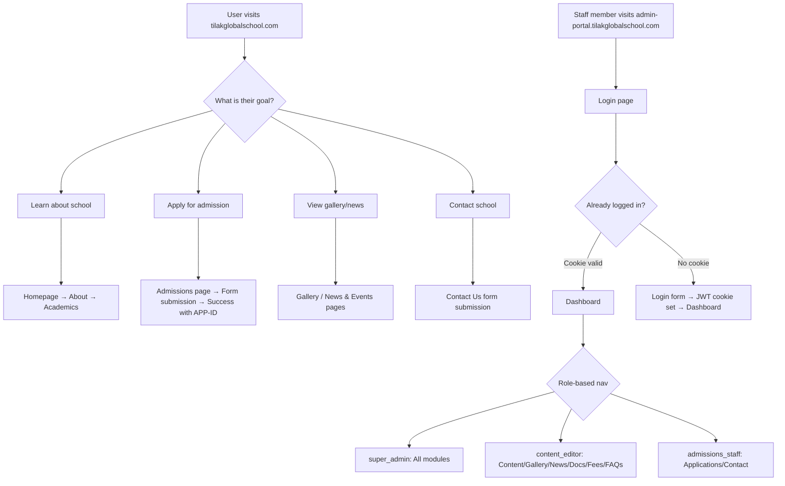
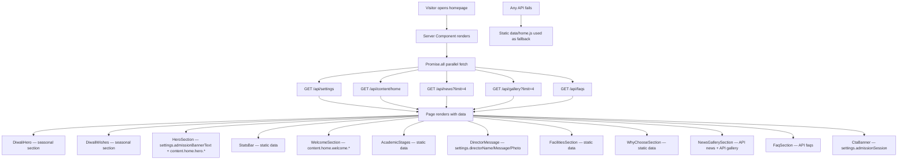
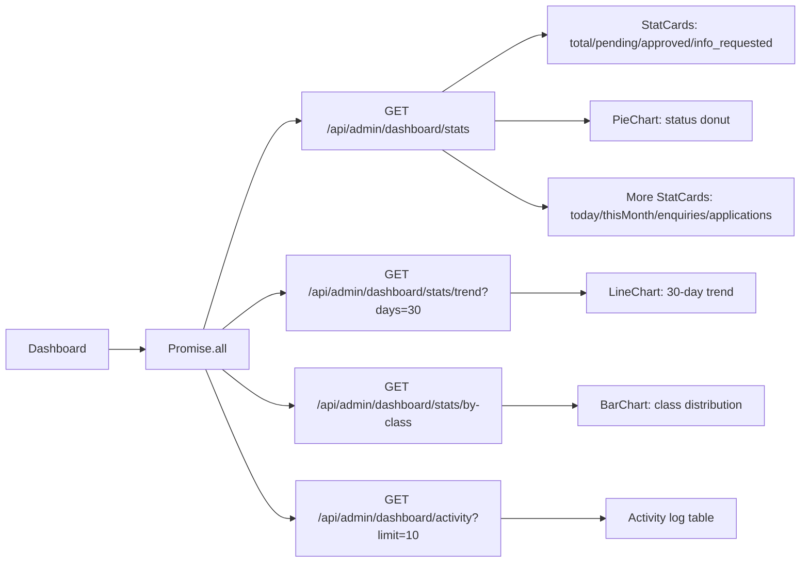
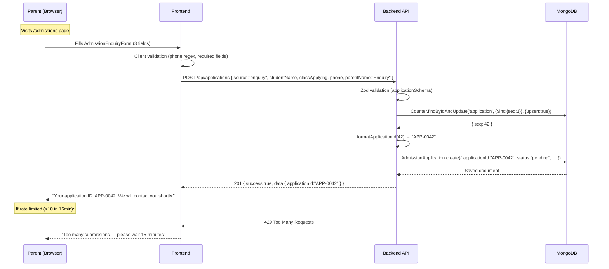
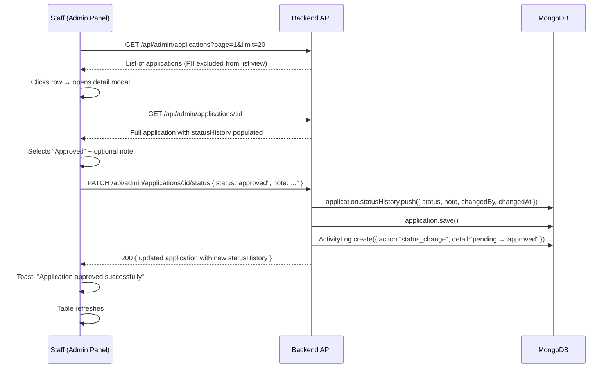
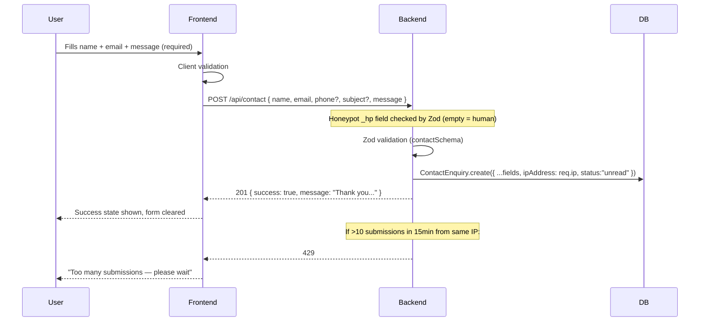
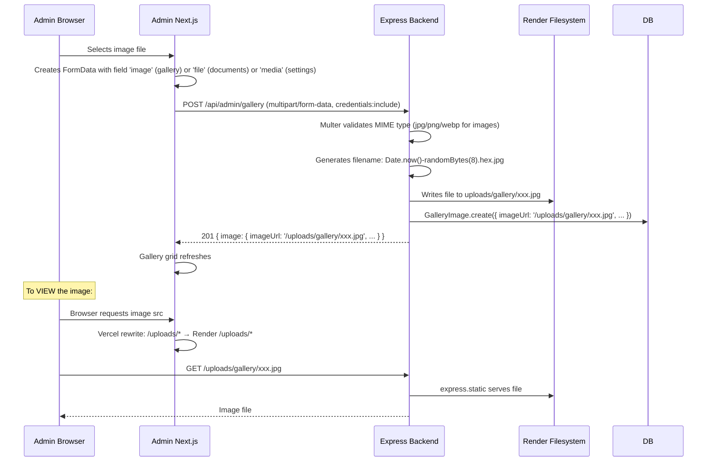

# Application Flow Document
## Tilak Global School — Website & CMS Platform

> **Version:** 1.0  
> **Date:** November 2026

---

## 1. Overall Application Flow



---

## 2. Website Entry Points

| Entry Point | URL | Type | Description |
|---|---|---|---|
| Public Homepage | `tilakglobalschool.com/` | Public | Primary landing page |
| Admissions | `tilakglobalschool.com/admissions` | Public | Admission info + forms |
| Gallery | `tilakglobalschool.com/gallery` | Public | Photo gallery |
| News & Events | `tilakglobalschool.com/news-events` | Public | News list |
| Individual Post | `tilakglobalschool.com/news-events/[slug]` | Public | Single news/event post |
| Downloads | `tilakglobalschool.com/downloads` | Public | Mandatory disclosures + documents |
| Contact | `tilakglobalschool.com/contact-us` | Public | Contact form |
| Admin Login | `admin-portal.tilakglobalschool.com/login` | Admin | Staff entry point |
| Admin Dashboard | `admin-portal.tilakglobalschool.com/` | Admin (auth) | Post-login landing |
| `/admin` on public site | `tilakglobalschool.com/admin` | Blocked | Returns HTTP 404 |

---

## 3. Landing Page Flow



---

## 4. Navigation Structure

### Public Site Navigation

```
Home (/)
├── About Us (/about-us)
│   ├── Our School (/about-us/our-school)
│   ├── Vision & Mission (/about-us/vision-mission)
│   ├── Principal's Message (/about-us/principals-message)
│   └── Infrastructure (/about-us/infrastructure)
├── Academics (/academics)
│   ├── Curriculum (/academics/curriculum)
│   ├── Faculty (/academics/faculty)
│   └── Academic Calendar (/academics/academic-calendar)
├── Admissions (/admissions)
│   ├── Admission Process (/admissions/admission-process)
│   ├── Fee Structure (/admissions/fee-structure)
│   └── Online Admission Form (/admissions/online-admission-form)
├── Gallery (/gallery)
├── News & Events (/news-events)
│   └── [slug] (/news-events/:slug) ← dynamic
└── Contact Us (/contact-us)

Footer:
├── Quick Links (same as nav)
├── Important Links
│   ├── Admission Enquiry
│   ├── Careers (/careers)
│   ├── Downloads (/downloads)
│   └── Privacy Policy (/privacy-policy)
└── Contact info
```

### Admin Panel Navigation

```
/ (Dashboard)
/login
/admissions
/gallery
/news
/content
/documents
/fees
/faqs
/contact
/settings
/users
```

---

## 5. All Available Pages and Routes

### Frontend Pages

| Route | Component File | Type | Data Source |
|---|---|---|---|
| `/` | `(user)/page.jsx` | Async Server | API (settings, content, news, gallery, faqs) |
| `/about-us` | `(user)/about-us/page.jsx` | Server | Static (data/about.js) |
| `/about-us/our-school` | Sub-page | Server | Static |
| `/about-us/vision-mission` | Sub-page | Server | Static |
| `/about-us/principals-message` | Sub-page | Server | Static |
| `/about-us/infrastructure` | Sub-page | Server | Static |
| `/academics` | `(user)/academics/page.jsx` | Server | Static (data/academics.js) |
| `/academics/curriculum` | Sub-page | Server | Static |
| `/academics/faculty` | Sub-page | Server | Static |
| `/academics/academic-calendar` | Sub-page | Server | Static |
| `/admissions` | `(user)/admissions/page.jsx` | Server + Client | API (fees, faqs) + forms |
| `/admissions/admission-process` | Sub-page | Server | Static |
| `/admissions/fee-structure` | Sub-page | Async Server | API (fees) |
| `/admissions/online-admission-form` | Sub-page | Server + Client | Form submit |
| `/gallery` | `(user)/gallery/page.jsx` | Async Server | API (gallery) |
| `/gallery/photo-gallery` | Sub-page | Static stub | — |
| `/gallery/video-gallery` | Sub-page | Static stub | — |
| `/news-events` | `(user)/news-events/page.jsx` | Async Server | API (news) |
| `/news-events/[slug]` | Dynamic route | Async Server | API (news/:slug) |
| `/contact-us` | `(user)/contact-us/page.jsx` | Client Component | API (contact POST) |
| `/downloads` | `(user)/downloads/page.jsx` | Async Server | API (documents) |
| `/careers` | Static stub | Server | None |
| `/privacy-policy` | Static stub | Server | None |
| `/admin` | `admin/page.jsx` | — | Returns `notFound()` |

### Admin Panel Pages

| Route | Component File | Auth Required |
|---|---|---|
| `/login` | `login/page.jsx` | No |
| `/` | `page.jsx` (Dashboard) | Yes |
| `/admissions` | `admissions/page.jsx` | Yes + permission |
| `/gallery` | `gallery/page.jsx` | Yes + permission |
| `/news` | `news/page.jsx` | Yes + permission |
| `/content` | `content/page.jsx` | Yes + permission |
| `/documents` | `documents/page.jsx` | Yes + permission |
| `/fees` | `fees/page.jsx` | Yes + permission |
| `/faqs` | `faqs/page.jsx` | Yes + permission |
| `/contact` | `contact/page.jsx` | Yes + permission |
| `/settings` | `settings/page.jsx` | Yes + super_admin only |
| `/users` | `users/page.jsx` | Yes + super_admin only |

---

## 6. Authentication Flow

```mermaid
sequenceDiagram
    participant B as Browser (Admin Panel)
    participant N as Next.js (Vercel)
    participant A as Express API (Render)
    participant DB as MongoDB Atlas

    Note over B: User opens admin-portal.tilakglobalschool.com
    B->>N: GET /
    N->>A: GET /api/auth/me (credentials: include)
    A-->>N: 401 Unauthorized (no cookie)
    N-->>B: Redirect to /login

    Note over B: User fills email + password
    B->>N: POST /api/auth/login via Vercel rewrite
    N->>A: POST /api/auth/login (proxied)
    A->>DB: AdminUser.findOne({ email }).select('+passwordHash')
    DB-->>A: User document
    A->>A: bcrypt.compare(password, hash)
    A->>A: signToken({ id, email, name, role, permissions })
    A-->>B: 200 + Set-Cookie: adminToken=<JWT>; HttpOnly; SameSite=None; Secure
    B->>N: GET / 
    N->>A: GET /api/auth/me (cookie sent automatically)
    A->>A: jwt.verify(token, JWT_SECRET)
    A->>DB: AdminUser.findById(id)
    DB-->>A: Fresh user data
    A-->>N: 200 { user: { id, name, email, role, permissions } }
    N-->>B: Dashboard renders with user data
```

---

## 7. Admin Login and Logout Flow

### Login
1. User visits `admin-portal.tilakglobalschool.com`
2. `AuthContext` calls `adminApi.me()` → `GET /api/auth/me`
3. If 401 → `AdminShell` redirects to `/login`
4. User submits email + password → `adminApi.login(email, password)` → `POST /api/auth/login`
5. Backend: finds user, bcrypt compare, signs JWT, sets `adminToken` httpOnly cookie
6. `AuthContext.setUser(res.data.user)` → `AdminShell` renders shell with sidebar
7. Router redirects to `/`

### Logout
1. User clicks "Sign Out" in TopBar profile dropdown
2. `useAuth().logout()` → `adminApi.logout()` → `POST /api/auth/logout`
3. Backend: `clearTokenCookie(res)` → `res.clearCookie('adminToken', options)`
4. `AuthContext.setUser(null)` → `AdminShell` triggers redirect to `/login`

### Session Restoration
1. User refreshes page or returns to admin
2. `AuthContext useEffect` calls `adminApi.me()` on mount
3. If cookie still valid → user data restored, renders normally
4. If cookie expired → user data null → redirect to login

---

## 8. Dashboard Flow



---

## 9. Admission Application Flow



### Admin Processing Flow



---

## 10. Contact Form Flow



---

## 11. CMS Content Editing Flow

```mermaid
flowchart TD
    Admin[Admin opens Content page] --> Tab[Selects page tab: home/about/academics...]
    Tab --> Fetch[GET /api/admin/content/page/:page]
    Fetch --> Sections[Blocks grouped by section, displayed]
    Sections --> Edit[Admin clicks Edit on a block]
    Edit --> Modal[Edit modal opens with current value]
    
    Modal --> SaveDraft[Admin clicks Save Draft]
    Modal --> Publish[Admin clicks Save & Publish]
    
    SaveDraft --> PUT1[PUT /api/admin/content/block?key=xxx { draftValue: newText }]
    PUT1 --> DB1[Block.draftValue = newText, hasDraft = true]
    DB1 --> Badge[Draft badge shown on block]
    Badge --> PublishDraft[Admin clicks Publish Draft]
    PublishDraft --> PATCH1[PATCH /api/admin/content/block/publish?key=xxx]
    PATCH1 --> DB2[value = draftValue, draftValue = null, hasDraft = false]
    
    Publish --> PUT2[PUT /api/admin/content/block?key=xxx { value: newText }]
    PUT2 --> DB3[Block.value = newText, publishedAt = now]
    
    DB2 & DB3 --> Live[Public site shows new content on next request]
```

---

## 12. Settings Update Flow

```mermaid
flowchart TD
    S[Admin opens Settings page] --> Load[GET /api/admin/settings]
    Load --> Form[All sections populated]
    
    Form --> Edit[Admin edits fields]
    Edit --> Save[Clicks Save Changes]
    Save --> PUT[PUT /api/admin/settings { ...fields }]
    Note1[logoUrl, faviconUrl, directorPhotoUrl stripped before PUT]
    PUT --> DB[SiteSettings.updateSingleton]
    DB --> Toast[Toast: Settings saved]
    
    Upload[Admin uploads logo/favicon/director photo] --> FD[FormData with 'media' field]
    FD --> POST[POST /api/admin/settings/logo]
    POST --> Multer[Multer validates MIME, saves to uploads/media/]
    Multer --> DB2[SiteSettings.logoUrl = /uploads/media/xxx.jpg]
    
    DB & DB2 --> HeaderFooter[Next page load: HeaderServer fetches /api/settings → Header/Footer show new data]
```

---

## 13. File Upload Flow



---

## 14. Error and Validation Flows

### Validation Error (Zod)
1. Client submits POST/PUT with invalid data
2. `validate(schema)` middleware calls `schema.safeParse(req.body)`
3. If fails: returns `422 { success: false, message: "Validation failed.", errors: [{ field, message }] }`
4. Controller never called

### Authentication Error
1. Request to `/api/admin/*` without valid cookie
2. `authenticate` middleware: no cookie → `401 { success: false, message: "Not authorized, please login" }`
3. Admin panel client: `adminApi` throws error with `type: 'UNAUTHORIZED'`

### File Too Large
1. User uploads file > MAX_FILE_SIZE_MB
2. Multer throws `MulterError('LIMIT_FILE_SIZE')`
3. `handleUploadError` returns `400 { success: false, message: "File too large. Maximum allowed size is 10 MB." }`

### Not Found
1. Request to unknown route
2. `notFound` middleware: `next(new AppError('Route not found: /xxx', 404))`
3. `errorHandler` returns `404 { success: false, message: "Route not found: /xxx" }`

### Rate Limit
1. >10 form submissions from same IP in 15min
2. `express-rate-limit` returns `429 { success: false, message: "Too many submissions..." }`
3. Frontend shows specific "Too many submissions" error message

---

## 15. API Request and Response Flow

```mermaid
flowchart TD
    Browser -->|/api/* request| Vercel[Vercel Edge]
    Vercel -->|rewrite /api/* → Render| Render[Render Backend]
    
    Render --> Helmet[helmet middleware]
    Helmet --> Morgan[morgan logging]
    Morgan --> BodyParser[express.json + urlencoded]
    BodyParser --> CookieParser[cookieParser]
    CookieParser --> CORS[CORS check]
    CORS --> Static[/uploads static check]
    Static --> RateLimit[generalApiLimiter]
    RateLimit --> Router[Route match]
    
    Router -->|/api/admin/*| Auth[authenticate middleware]
    Auth -->|invalid| Err401[401 JSON]
    Auth -->|valid| Permission[requirePermission / requireRole]
    Permission -->|denied| Err403[403 JSON]
    Permission -->|allowed| Validate[Zod validate middleware]
    Validate -->|invalid| Err422[422 JSON]
    Validate -->|valid| Controller[Controller async handler]
    
    Controller --> DB[MongoDB Atlas operation]
    DB -->|success| Response[sendSuccess → { success:true, data, meta }]
    DB -->|error| ErrorHandler[global errorHandler]
    ErrorHandler --> ErrorResponse[{ success:false, message }]
```

---

## 16. Protected Routes

### Admin Panel Protected Routes

All admin routes except `/login` are protected by `AdminShell`:

```
useEffect: if (!loading && !user && pathname !== '/login') {
  router.replace('/login');
}
```

Additionally, server-side route protection exists on the Express side for all `/api/admin/*` endpoints via `authenticate` middleware.

### Public Site Route Blocking
- `/admin` → `notFound()` (Next.js returns 404 immediately)
- No other public routes are protected

---

## 17. User Journey Maps

### Parent Journey: Admission Enquiry

```
1. Google Search: "CBSE school Jaipur nursery admission 2026"
        ↓
2. Lands on Homepage
   - Sees admission banner in hero ("Admissions Open · Session ...")
   - Scrolls through welcome, academic stages, facilities
        ↓
3. Clicks "Enquire for Admission" CTA button
        ↓
4. Lands on /admissions page
   - Reads 4-step admission process
   - Reviews documents required
   - Sees fee structure table
        ↓
5. Fills AdmissionEnquiryForm (3 fields: student name, class, mobile)
        ↓
6. Receives: "Your application ID: APP-0042. We will contact you shortly."
        ↓
7. School staff sees application in admin panel
   - Reviews details
   - Updates status to "approved" or "info_requested" with note
```

### Staff Journey: Processing Applications

```
1. Opens admin-portal.tilakglobalschool.com
        ↓
2. Logs in with email + password
        ↓
3. Dashboard shows: total=42, pending=15, approved=20, info_requested=7
        ↓
4. Navigates to Admissions page
        ↓
5. Sees table: searches by name "Sharma", filter by class "Nursery"
        ↓
6. Clicks row → sees full application detail modal
        ↓
7. Clicks "Approve" → optional note → "Confirm"
        ↓
8. Status updated, history recorded, table refreshes
```

### Staff Journey: Publishing News Post

```
1. Admin panel → News page
        ↓
2. Clicks "New Post"
        ↓
3. Fills title, category (News/Event/Notice), date, summary, body
        ↓
4. Saves as Draft (default status)
        ↓
5. Sees post in list with "draft" badge
        ↓
6. Reviews post → clicks Publish (eye icon)
        ↓
7. Post now live at /news-events on public site
        ↓
8. Post appears in homepage NewsGallerySection accordion (if in top 4 latest)
```

---

## 18. Redirect Flows

| Scenario | From | To | How |
|---|---|---|---|
| Admin not logged in | Any admin route | `/login` | AdminShell useEffect + router.replace |
| Admin already logged in | `/login` | Not redirected (manual visit shows login form) | No auto-redirect from login |
| Public visits /admin | `/admin` | 404 page | Next.js `notFound()` |
| Login success | `/login` | `/` (dashboard) | `router.replace('/')` in login page |
| Logout | Any admin page | `/login` | AuthContext.logout → setUser(null) → AdminShell redirect |
| `/news-events/[slug]` not found | — | 404 | `notFound()` in page.jsx |

---

## 19. Mermaid: Complete Admin Permission Flow

```mermaid
flowchart TD
    Request[Incoming /api/admin/* request] --> Cookie{Cookie adminToken present?}
    Cookie -->|No| R401[Return 401 JSON]
    Cookie -->|Yes| Verify{jwt.verify success?}
    Verify -->|No| R401
    Verify -->|Yes| Payload[req.admin = decoded payload]
    Payload --> RouteCheck{Route type?}
    
    RouteCheck -->|requireRole super_admin| RoleCheck{req.admin.role === super_admin?}
    RoleCheck -->|No| R403[Return 403 JSON]
    RoleCheck -->|Yes| Handler[Controller]
    
    RouteCheck -->|requirePermission module.action| PermCheck{req.admin.permissions.module.action === true?}
    PermCheck -->|No| R403
    PermCheck -->|Yes| Handler
    
    RouteCheck -->|No special guard| Handler
    
    Handler --> AsyncHandler[asyncHandler wraps try/catch]
    AsyncHandler --> DB[MongoDB operation]
    DB -->|Success| Send200[sendSuccess response]
    DB -->|Error| NextErr[next(error) → errorHandler]
```
